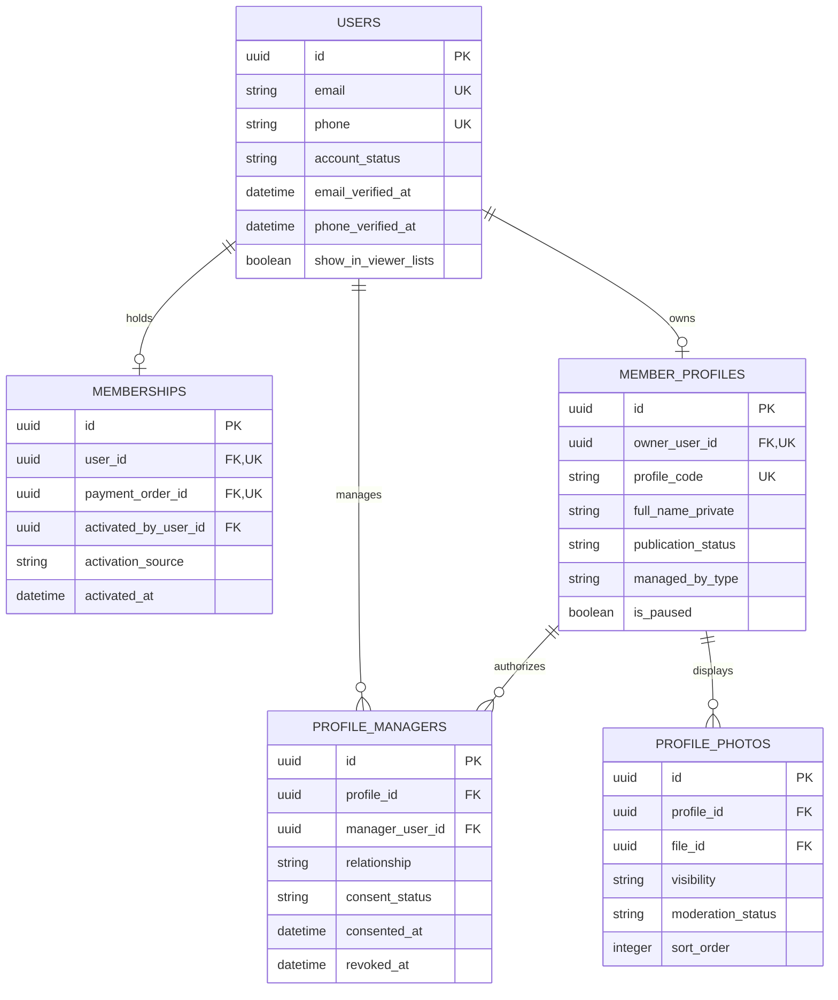
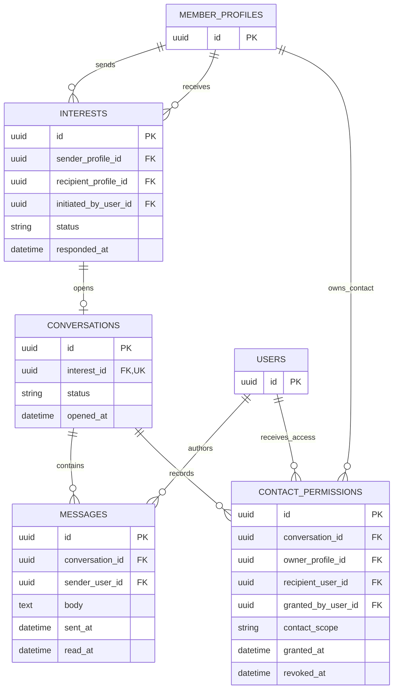
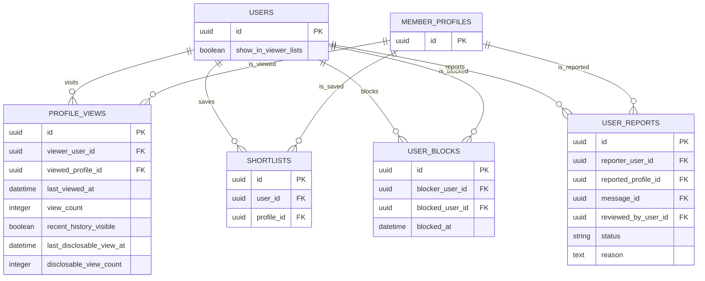
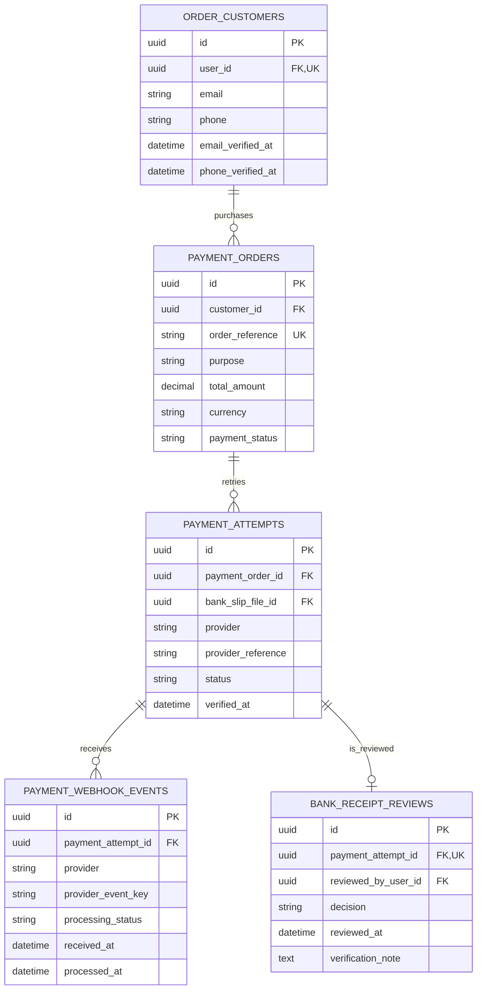
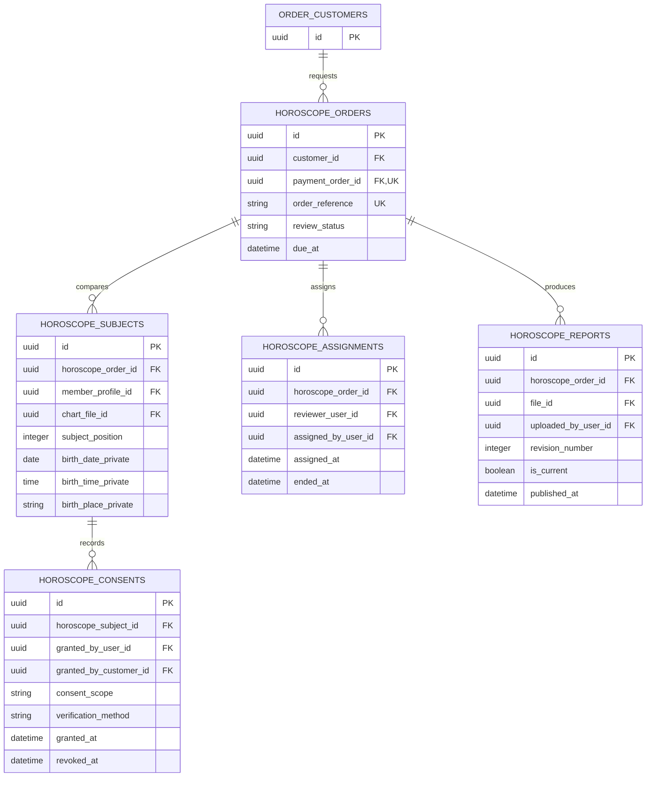
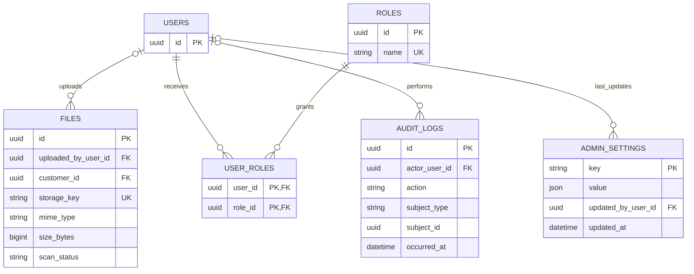

# Matchmaking Website — Product & Development Plan

**Version:** 1.3  
**Prepared:** 19 October 2026  
**Client:** Existing marriage proposal and horoscope service agency  
**Brand / domain:** To be decided  
**Document status:** Updated baseline with confirmed business decisions

**Latest update:** Added confirmed launch scope (Sri Lanka & Overseas), bilingual support (Sinhala & English), and dynamic admin-configurable pricing for registration and horoscope matching.

> අපි සාකච්ඡා කළ website plan එකෙහි නවතම තීරණ (Global/Local launch scope, Sinhala & English bilingual support, Admin-configurable pricing, Contact release policy, Lifetime registration, Payment verification, සහ Free-mode feature parity) යාවත්කාලීන කර මෙහි දක්වා ඇත.

---

## 1. Project Purpose

Build a matrimonial website that extends the agency's existing marriage proposal and horoscope services online. Visitors can browse limited public profiles. Registered members need an active account to contact other members or use messaging. Account activation normally requires a one-time registration payment, with an administrator-controlled free registration mode.

Offer horoscope matching as a separate paid service. People outside the matrimonial membership can also submit two horoscopes, pay, and receive a reviewed report without publishing a matrimonial profile.

Primary audience: Sri Lankan marriage seekers and families (both residing in Sri Lanka and overseas Sri Lankans worldwide). Launch languages: Sinhala and English.

---

## 2. Requirement Status

| Status | Meaning |
| --- | --- |
| Confirmed | Explicitly requested or accepted in the discussion |
| Recommended | Proposed design or implementation baseline; review before implementation |
| Open | A business decision that has not yet been made |

### Confirmed requirements

- **Business Foundation:** The client already operates a marriage proposal / horoscope-related business.
- **Public Browsing:** Unregistered visitors can browse profiles, with strictly restricted information.
- **Access Gate:** Contact access, expressing interest, and messaging require a registered, active account.
- **Membership Model:** **Lifetime / One-time registration payment**. There is no recurring monthly/annual expiration date unless an account is manually suspended or closed.
- **Payment & Verification:**
  - Online payments handled via **PayHere** (automatic activation upon successful webhook verification).
  - **Direct Bank Transfer** payments require manual agency staff verification and confirmation before account activation.
- **Free Mode & Feature Parity:** 
  - Administrators can toggle `registration_payment_required = ON / OFF`.
  - When Free Mode is active (`OFF`), members receive **full feature parity** (they can use every messaging, interest, and contact request feature available to paid members).
- **Contact Release Policy:** **Owner-approved release**. Even for active members, private contact details are never directly revealed without the explicit consent/acceptance of the profile owner.
- **Horoscope Matching:** Separate paid service, independent of the matrimonial registration fee. Non-members can purchase horoscope matching for their own pair of horoscopes.
- **Viewer History:**
  - Members can see their previously viewed profiles under Recently Viewed.
  - Members can see who viewed their profile under Who Viewed Me, subject to agreed privacy rules.
- **Phased Rollout:** Planned progression across core matrimonial, agency operations, and horoscope services.
- **Geographic Reach:** Open to all marriage seekers and families (living in Sri Lanka as well as overseas Sri Lankans worldwide).
- **Supported Languages:** Bilingual launch supporting **Sinhala** and **English**.
- **Admin-Configurable Pricing:** The one-time registration fee and horoscope matching fee amounts are dynamically managed by administrators via Filament Admin Settings (`ADMIN_SETTINGS` table) without requiring code modifications.

### Recommended technical direction

Next.js + TypeScript for the public/member frontend; Laravel for the API, business rules, and operations; PostgreSQL for persistent data; Filament for agency administration.

### Remaining open decisions

- Refund policy and revision handling for horoscope reports?

---

## 3. User Roles

| Role | Purpose |
| --- | --- |
| Public visitor | Browse limited profiles and learn about the services |
| Registered, inactive member | Complete profile, view pending state, upload bank slip, or complete payment |
| Active member | Use contact requests, messaging, and shortlisted features (Lifetime access) |
| Parent / guardian profile manager | Manage a candidate's profile with the candidate's consent |
| Horoscope customer | Purchase a report without creating a matrimonial profile |
| Agency staff | Assist customers, verify bank receipts, review profiles, and process assigned work |
| Horoscope reviewer | Access assigned horoscope orders and upload reports |
| Administrator | Manage settings (Free Mode toggle, fees), staff permissions, payments, and system operations |

---

## 4. Access and Privacy Matrix

| Action | Visitor | Inactive member | Active member (Paid / Free-mode) | Authorized staff |
| --- | --- | --- | --- | --- |
| Browse approved public profiles | Yes | Yes | Yes | Yes |
| Search public profile fields | Yes | Yes | Yes | Yes |
| Create / edit own candidate profile | Register first | Yes | Yes | Assist with permission |
| View own Recently Viewed list | No | Recommended | Yes | No general need |
| View Who Viewed Me list | No | Proposed activation gate | Yes, subject to privacy rules | Authorized operational purpose |
| Send an interest / proposal | No | No | Yes | Act through approved workflows |
| Access private contact details | No | No | **Only after owner approves request** | Role restricted |
| Buy a horoscope report | Yes, after contact verification | Yes | Yes | Create an assisted order |
| Download a horoscope report | Verified order access only | Own authorized orders | Own authorized orders | Assigned role only |

---

## 5. Public Website

### Suggested pages

- **Home:** Search bar, service overview, step-by-step guide, and call to action.
- **Browse Profiles:** Paginated cards with public-safe attributes.
- **Public Profile:** Verified non-identifying details, photo (if public), and an "Express Interest / Connect" button leading to login/activation.
- **Membership:** Transparent explanation of the one-time registration fee and included lifetime benefits.
- **Horoscope Matching:** Service details, required birth information/charts, pricing, and estimated turnaround time.
- **Track Horoscope Order:** Secure status verification and report download.
- **About the Agency:** Physical address, credentials, and agency history.
- **FAQ / Contact / Privacy & Terms.**

### Search filters & Profile cards

- Filters: Age range, gender (bride/groom), district/location, religion, education, occupation, marital status, and horoscope availability.
- Profile cards show: Unique profile code, age, district, occupation, highest education, and approved primary photo.
- **Never public:** Legal full names, telephone numbers, postal addresses, national identity documents, and exact birth times.

---

## 6. Registration, Payment & Activation Workflow

### Registration flows

```
[Visitor Registration]
         │
         ▼
[Verify Phone/Email OTP]
         │
         ▼
[Complete Basic Profile]
         │
         ▼
Check System Setting: `registration_payment_required`
   ├── OFF (Free Mode) ──────► [Immediate Activation (Full Features Enabled)]
   └── ON (Paid Mode)
         ├── Online Gateway (PayHere) ──► Instant Webhook Check ──► [Auto Activation]
         └── Bank Transfer Deposit ─────► Upload Slip ──────────► [Pending Staff Verification]
                                                                          │
                                                                 (Staff confirms receipt)
                                                                          │
                                                                          ▼
                                                                 [Manual Activation]
```

### Core activation principles

1. **One-Time Registration:** Once activated, the membership remains permanently active (lifetime) unless banned or voluntarily closed.
2. **Feature Parity in Free Mode:** When registration payment is turned OFF by admin, members who register and verify their profile have full access to send interests, view profiles, and message, exactly like paid members.
3. **Decoupled Verification:** A verified payment (or free mode activation) grants system access, but the profile content remains subject to independent agency moderation before becoming visible in public search.

---

## 7. Profile Creation & Family Management

- **Candidate vs Manager:** Clear indication whether the profile is managed by Self, Mother, Father, or Guardian.
- **Agency-assisted entry:** Staff can draft a profile for walk-in or telephone clients, triggering a claim invite via SMS/email without plaintext passwords.
- **Photo Privacy:** Members can toggle photos between public, members-only, or hidden until an interest is accepted.

---

## 8. Interests, Contact Sharing & Messaging

### Owner-Approved Contact Flow (Confirmed)

1. **Express Interest:** Member A (active) sends an interest request to Member B (active).
2. **Response:** Member B receives an alert and can choose to **Accept**, **Decline**, or **Block**.
3. **Private Chat:** Upon acceptance, a secure internal messaging channel is opened between Member A and Member B.
4. **Contact Release:** Phone numbers and direct contact details are revealed **only when the profile owner explicitly grants contact release permission** within the conversation or settings.
5. **Messaging Rules:**
   - Text-only conversations with unread indicators and report/block actions.
   - Configurable daily interest request limits to prevent spamming.

---

## 9. Recently Viewed & Who Viewed Me

### Recently Viewed (Private to the user)
- Chronological list of profiles viewed by the logged-in member.
- Re-visiting a profile bumps the timestamp rather than creating duplicate entries.
- Clear history option provided.

### Who Viewed Me
- Shows which active members opened your profile card/page.
- Deduplicated (shows latest visit date and aggregate view count).
- Respects privacy: Members who disable their visibility in others' viewer lists cannot see named viewers on their own profile (reciprocal visibility rule).

---

## 10. Separate Paid Horoscope Service

- **Available to Everyone:** Matrimonial membership is not required.
- **Guest / Outside Orders:** Requires a verified phone number or email for order status lookup.
- **Process:**
  1. Customer submits two horoscopes (file uploads or birth details).
  2. Customer pays via PayHere or Bank Transfer.
  3. Order queued in Filament admin for in-house astrologer / horoscope reviewer.
  4. Reviewer uploads completed PDF report.
  5. Customer receives notification and downloads report securely via short-lived signed URL.

---

## 11. Agency Administration (Filament Panel)

- **Payment Reconciliation:** Dedicated interface to review uploaded bank slips, match bank statement references, approve payments, and trigger member activation.
- **Profile Moderation:** Queue for pending profile updates, flagging inappropriate content or photos.
- **Horoscope Queue:** Assign incoming horoscope matching orders to reviewers and track delivery deadlines.
- **Global Settings:**
  - `registration_payment_required` (ON / OFF).
  - One-time registration fee amount.
  - Horoscope matching service fee amount.
  - PayHere merchant credentials & banking deposit instructions.

---

## 12. Technical Architecture & Data Model

### Technology Stack
- **Frontend:** Next.js (App Router), TypeScript, Tailwind CSS, shadcn/ui.
- **Backend API:** Laravel 11/12 REST API, Laravel Sanctum (session/cookie auth).
- **Administration:** Filament v3.
- **Database:** PostgreSQL.
- **Realtime Messaging:** Laravel Reverb + Echo.
- **Storage:** S3-compatible private object storage for slips, horoscope PDFs, and identity documents.

### Key Database Entities

The ERD is split into six related domains so each diagram remains readable. An entity repeated across diagrams is the **same database table**, not another copy. This is a proposed implementation schema for the confirmed product rules; migrations should follow after schema review.

**Notation:** `PK` = primary key, `FK` = foreign key, `UK` = unique key. `||` = exactly one; `o|` = zero or one; `o{` = zero or many. UUID keys are proposed throughout. Diagrams show key fields rather than every application field; nullable fields and composite constraints are specified in Section 12.8. Standard `created_at` and `updated_at` fields are omitted for brevity.

### 12.1 Identity, Lifetime Membership & Candidate Profiles



- A user may be staff, a profile manager, a member, or a combination of authorized roles. Staff and horoscope-only customers do not need a candidate profile.
- Proposed launch model: at most one owned candidate profile and one lifetime membership per user. Multiple profiles managed by one family account remain a scope decision; the manager table supports that extension without making it a confirmed launch feature.
- Profile managers must have valid consent. Candidate consent evidence is recorded through the profile-management workflow; a checkbox from an unauthorized person is not sufficient evidence by itself.
- Free-mode activation creates a membership with `activation_source = free_mode` and no payment order. Paid activation links the verified registration order. No recurring expiry field is needed for lifetime access.
- `account_status` controls suspension/closure, `MEMBERSHIPS` records entitlement, and `publication_status` controls public profile availability. These are separate decisions. A payment must never override suspension or publish an unapproved profile.
- `full_name_private` is never part of a public profile response. Add birth, family, location, education, occupation, partner preferences, verification evidence, and consent metadata to the detailed schema; optional filterable fields should use appropriate typed columns or lookup tables.

### 12.2 Interests, Private Conversations & Contact Permission



- Conversation participants are the two profiles referenced by the accepted interest. Access is limited to the currently authorized account holders/managers for those profiles.
- Only an accepted interest may open a conversation. Both parties must satisfy the active-account rule. Block and suspension checks apply to APIs and Reverb channel authorization.
- Interest acceptance opens chat; it **does not automatically grant phone-number access**.
- Contact permissions are directional: owner A granting access to user B does not grant B's contact details to A. Store the grantor and scope, such as phone/email, and allow revocation.
- A parent/guardian may grant contact release only where the candidate's management consent explicitly delegates that action. Permission goes to the named user; newly added managers do not inherit old contact grants automatically.
- Granting and reading contact details must verify that the owner profile and recipient belong to opposite sides of the same conversation. The recipient must still be eligible and unblocked. Revocation stops future disclosure; it cannot erase information someone already saw.
- `read_at` is adequate for a launch conversation with one designated recipient account per message. If multiple managers will independently read the same conversation at launch, add `MESSAGE_READS(message_id, user_id, read_at)` with a composite unique key instead.

### 12.3 Recently Viewed, Who Viewed Me & Member Safety



- Use one `PROFILE_VIEWS` row per `(viewer_user_id, viewed_profile_id)`. Repeat visits update timestamps and counters atomically.
- Recently Viewed uses `last_viewed_at` and `recent_history_visible`. Clearing history sets that member's rows to hidden; the next visit makes the relevant row visible again. Do not delete another person's viewer-disclosure history merely because the visitor cleared their own list.
- Who Viewed Me uses `last_disclosable_view_at` and `disclosable_view_count`, filtered by both members' current eligibility and the reciprocal visibility setting. Private visits must not update named-disclosure timestamps or counters. Turning visibility back on must not reveal previously private visits retroactively.
- Exclude self-views and staff moderation views. A card impression alone should not count; record a profile-detail open. Tracking logged-out counts is optional and must not assign an invented identity.
- Block records are directional, but discovery, messaging, contact, shortlist, and view-list checks must respect a block in **either** direction. A candidate-profile-level block should also prevent an authorized manager account from bypassing that restriction.
- Reports can reference a particular message when applicable. The reported message must belong to a conversation involving the reported profile; reviewers need explicit moderation permissions.

### 12.4 Customers, Payment Orders & Bank Verification



- `ORDER_CUSTOMERS.user_id` is optional, allowing a verified guest customer without a `USERS` account. A linked user may have at most one customer identity. Do not auto-link guest orders solely because an unverified email matches an account.
- `PAYMENT_ORDERS.purpose` is `membership_registration` or `horoscope_matching`. Each order has one purpose. Keep a snapshot of the agreed price, currency, service description, and verified billing details even if settings change later.
- One order may have multiple attempts. A rejected bank receipt can be followed by a new attempt, preserving the original review history.
- `provider` is `payhere` or `bank_transfer`; a receipt upload leaves the bank attempt in `pending_verification` until staff confirms receipt of funds.
- For PayHere, validate the callback signature and compare order reference, merchant, amount, currency, and success state before marking the order paid. Browser redirect success does not authorize activation.
- Normalize a stable `provider_event_key` for replay protection using the gateway's actual callback fields; do not assume every provider supplies a standalone event ID. Authenticate a callback before applying any trusted state transition.
- Cross-domain link: `MEMBERSHIPS.payment_order_id` is zero-or-one-to-one for a paid registration. Free activation has no payment order. A registration order must belong to the member being activated.
- Apply successful payment fulfillment in a database transaction with idempotency guards. Multiple valid callbacks must not create multiple memberships or fulfill a horoscope order twice.

### 12.5 Standalone Horoscope Orders, Consent & Reports



- Each submitted matching order compares exactly two subjects. `subject_position` is 1 or 2. Drafts can be incomplete; require both records and valid inputs before checkout or submission.
- `member_profile_id` is optional for outside customers. `chart_file_id` is optional only when valid birth details are sufficient for the agency's selected service. Horoscope data remains private.
- Create a payment order for horoscope checkout and link it to this service order. Draft horoscope orders may initially have no payment order; paid/submitted work must have the correct verified `horoscope_matching` payment order and matching customer identity.
- Store consent evidence and scope for each subject. A guest's verified contact proves control of that contact, not authority over the other person's private data. Member-profile data requires the relevant owner's authorized consent workflow.
- Preserve assignment history; initially permit one current reviewer per order. Reassignment closes the previous assignment rather than overwriting it.
- Preserve report revisions. Publish only the authorized current revision; a replacement report should not overwrite evidence of the previous file and publication.
- Recommended `review_status`: `draft`, `awaiting_consent`, `awaiting_payment`, `queued`, `under_review`, `more_information_required`, `report_ready`, `completed`, `cancelled`. Payment and review states remain separate.
- Guest report access requires verified customer ownership or a securely verified order session before issuing a short-lived signed download URL. An order reference alone is never sufficient.
- The requester is the default report recipient. Any additional participant access needs an explicit authorization policy; do not infer it from inclusion as a horoscope subject.

### 12.6 Private Files, Staff Roles & Audit History



- `FILES` is shared by profile photos, payment slips, horoscope charts, and reports. `uploaded_by_user_id` may be null for guest uploads; `customer_id` links those uploads to a verified order customer. The owning feature's relationship determines file access; uploader identity alone does not authorize a download.
- Private files never have permanent public URLs. Publicly allowed profile images should use separate processed derivatives, not original identity-bearing files.
- Baseline roles: administrator, agency staff, and horoscope reviewer. Policies must also check order assignment, profile ownership/management, and scope; a role label alone does not grant access to every customer's data.
- Audit setting changes, bank approvals, membership activation, profile moderation, consent changes, assignments, and report publication. Automated actions may use a null actor with a recorded system context.
- `AUDIT_LOGS.subject_type + subject_id` is an application-managed polymorphic reference, **not** a PostgreSQL FK. Restrict supported subject types and preserve useful redacted metadata when subjects are removed.
- Keep PayHere merchant secrets and other credentials in protected runtime configuration or a dedicated encrypted secret store. `ADMIN_SETTINGS` contains non-secret business settings and banking instructions; never store plaintext gateway secrets there.

### 12.7 Cross-Domain Foreign Keys

The relationships below connect tables drawn in different diagrams. They are actual database foreign keys unless specifically noted otherwise.

| Column | Referenced column | Purpose / nullability |
| --- | --- | --- |
| `MEMBERSHIPS.payment_order_id` | `PAYMENT_ORDERS.id` | Nullable for free activation; unique when present |
| `MEMBERSHIPS.activated_by_user_id` | `USERS.id` | Nullable for automatic activation |
| `PROFILE_PHOTOS.file_id` | `FILES.id` | Processed photo asset |
| `INTERESTS.initiated_by_user_id` | `USERS.id` | Account that acted for the sender profile |
| `CONTACT_PERMISSIONS.granted_by_user_id` | `USERS.id` | Owner or explicitly authorized manager granting access |
| `USER_REPORTS.message_id` | `MESSAGES.id` | Optional message associated with a profile report |
| `USER_REPORTS.reviewed_by_user_id` | `USERS.id` | Nullable until reviewed |
| `ORDER_CUSTOMERS.user_id` | `USERS.id` | Nullable for outside customers |
| `PAYMENT_ATTEMPTS.bank_slip_file_id` | `FILES.id` | Nullable for PayHere; bank evidence when submitted |
| `BANK_RECEIPT_REVIEWS.reviewed_by_user_id` | `USERS.id` | Staff reviewer |
| `HOROSCOPE_ORDERS.payment_order_id` | `PAYMENT_ORDERS.id` | Nullable in draft; unique when present |
| `HOROSCOPE_SUBJECTS.member_profile_id` | `MEMBER_PROFILES.id` | Nullable for outside subjects |
| `HOROSCOPE_SUBJECTS.chart_file_id` | `FILES.id` | Optional if the agency accepts birth details instead |
| `HOROSCOPE_CONSENTS.granted_by_user_id` | `USERS.id` | Nullable for an authorized verified outside customer |
| `HOROSCOPE_CONSENTS.granted_by_customer_id` | `ORDER_CUSTOMERS.id` | Nullable for an authenticated user grant |
| `HOROSCOPE_ASSIGNMENTS.reviewer_user_id` | `USERS.id` | Assigned horoscope reviewer |
| `HOROSCOPE_ASSIGNMENTS.assigned_by_user_id` | `USERS.id` | Staff member making the assignment |
| `HOROSCOPE_REPORTS.file_id` | `FILES.id` | Private PDF report |
| `HOROSCOPE_REPORTS.uploaded_by_user_id` | `USERS.id` | Authorized report author/uploader |
| `FILES.customer_id` | `ORDER_CUSTOMERS.id` | Optional customer context, required for guest upload ownership |

### 12.8 Database Constraints, Indexes & Workflow Invariants

| Area | Required constraint or validation |
| --- | --- |
| Identity | Unique normalized email/phone when present; require at least one usable contact. Unique owner per candidate profile. |
| Managers | Unique `(profile_id, manager_user_id)`; revoked/invalid consent disables manager actions. |
| Membership | Unique `user_id`; unique non-null `payment_order_id`; source is `payhere`, `bank_transfer`, or `free_mode`. Validate source/payment consistency. |
| Interests | Sender and recipient profiles must differ. Prevent duplicate pending requests for the same unordered pair; define decline/retry rules before enabling retries. |
| Conversations | Unique `interest_id`; the linked interest must be accepted before opening chat. |
| Contact grants | At most one unrevoked grant per `(conversation_id, owner_profile_id, recipient_user_id, contact_scope)` using a partial unique index. Keep revoked records as history. |
| Views | Unique `(viewer_user_id, viewed_profile_id)`; indexes on `(viewer_user_id, last_viewed_at)` and `(viewed_profile_id, last_disclosable_view_at)`; nonnegative counters. |
| Shortlists | Unique `(user_id, profile_id)`; apply publication, pause, block, and visibility checks on reads. |
| Blocks | Unique `(blocker_user_id, blocked_user_id)`; no self-block; index the reverse direction for enforcement. |
| Money | Use fixed-precision decimal amounts, never floating point; positive order totals; explicit currency. Preserve price snapshots. |
| Payment attempts | Unique non-null `(provider, provider_reference)`; null references allowed before submission. Lock the order during fulfillment. |
| Webhooks | Unique `(provider, provider_event_key)`; invalid/replayed events cannot activate or fulfill an order. |
| Bank reviews | Unique `payment_attempt_id`; reviewed method must be `bank_transfer`; verify funds before approval. New receipt submissions use new attempts. |
| Service linkage | One successful order fulfills only its declared purpose. A membership-registration order cannot pay for a horoscope report or vice versa. |
| Horoscope subjects | Unique `(horoscope_order_id, subject_position)`; position restricted to 1 or 2; require exactly two valid subjects before checkout. |
| Horoscope consent | Exactly one grantor reference per consent: user or customer. Validate actual authority, required scope, revocation, and subject ownership. |
| Reviewer assignment | At most one unended assignment per horoscope order using a partial unique index. |
| Reports | Unique `(horoscope_order_id, revision_number)`; at most one current report per order; publication requires a valid completed file. |
| Role membership | Composite primary key `(user_id, role_id)`. |
| Retention | Define anonymization/deletion policy before migrations. Avoid destructive cascades across payments, consent evidence, or audit history. |

Simple uniqueness, FK, range, and nullability rules belong in PostgreSQL constraints. Cross-table rules—such as accepted interests, a paid order matching the service purpose, exactly two subjects at submission, and valid contact release—need transactional Laravel services/policies and, where appropriate, database triggers. A PostgreSQL `CHECK` constraint alone cannot inspect other table rows.

**Schema validation scenarios:** duplicate/replayed PayHere callbacks; free-mode activation without a payment order; a bank slip awaiting approval; attempted contact access before consent; a blocked participant opening a private channel; a hidden view after a public view; clearing Recently Viewed without deleting another person's disclosed history; and a verified guest retrieving only their own horoscope report.

---

## 13. Phased Implementation Roadmap

### Phase 0: Foundations & UX
- Finalize branding, color palette, and multi-language requirements.
- Wireframe mobile browsing, profile creation, and contact approval screens.
- Setup staging environment and database schema migrations.

### Phase 1: MVP Launch
- Public portal, search filters, and protected profile display.
- One-time registration with PayHere integration + Bank slip manual review workflow.
- Free Mode toggle support with complete feature parity.
- Owner-approved interest acceptance and private text messaging.
- Standalone paid horoscope order submission and PDF delivery.
- Filament admin dashboard for profile, payment, and order handling.

### Phase 2: Enhancements
- Saved searches and match alerts.
- Profile freshness reminders.
- Astrologer consultation bookings.

---

## 14. Acceptance Criteria Checklist

- [ ] A visitor cannot extract private contact numbers or full names via API response or page source.
- [ ] Successful PayHere webhook automatically activates lifetime membership without manual intervention.
- [ ] Bank deposit slip uploads remain in `pending_verification` until approved by staff in Filament.
- [ ] Turning Free Mode ON allows new users to access all messaging and interest features without payment.
- [ ] Contact details are strictly hidden until the recipient explicitly accepts contact sharing.
- [ ] Outside customers can order and download a horoscope matching report without creating a matrimonial candidate profile.
- [ ] S3 storage links for horoscope charts and reports are private and expire after a short time window.
